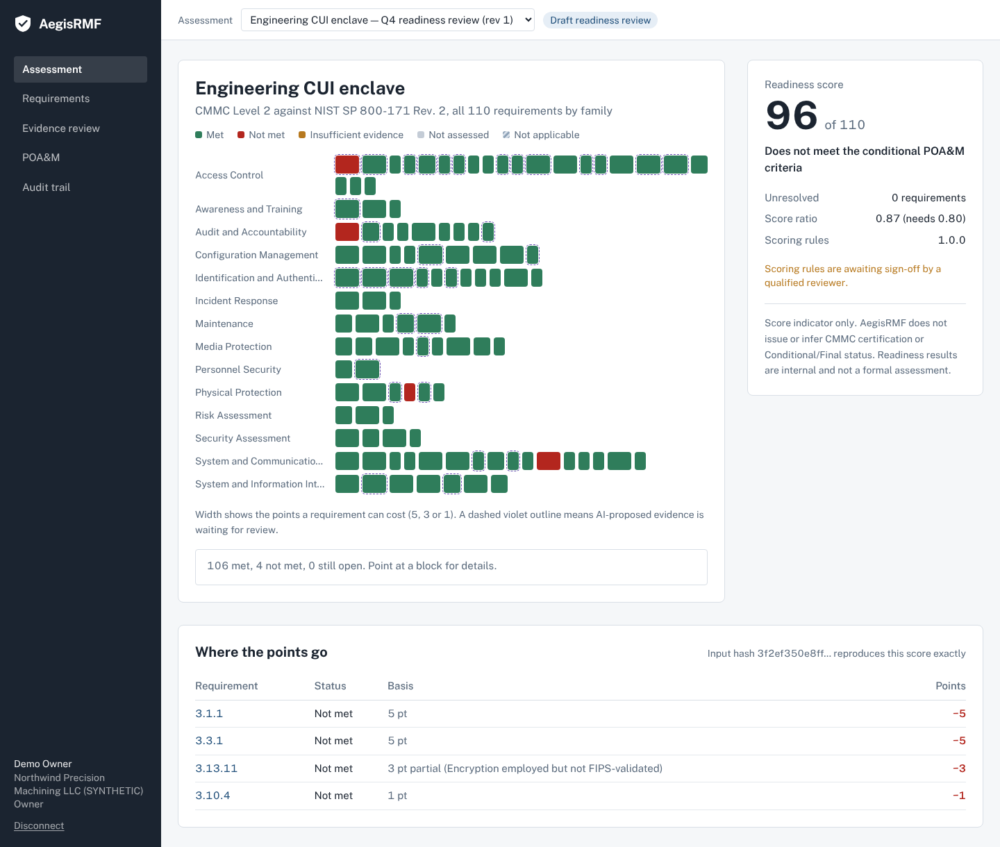

https://github.com/user-attachments/assets/d45f1b7b-64d8-4cad-9ab3-e7b2286dac42

# AegisRMF



**AI-assisted CMMC / NIST SP 800-171 readiness platform with deterministic, regulation-aligned scoring
and a secure Model Context Protocol (MCP) server.**

> **Built with Claude Code.** Product direction, CMMC scoring and POA&M rules, review of the AI's evidence
> mappings, and live Azure testing by Prince Boafo (CMMC-CCP, CISM).

AegisRMF lets a defense contractor, MSP or consultant scope a CUI boundary, upload evidence, get
AI-proposed evidence-to-objective mappings with exact citations, record human determinations, compute a
reproducible 32 CFR 170.24 score, manage POA&Ms under the 170.21 rules, and export an SSP draft and a
traceable, signed assessment report. The same workflows are available to approved AI agents over MCP,
read-only by default.

> AegisRMF produces **readiness indicators**. It never issues or infers CMMC certification, Conditional
> or Final status, or an ATO. AI output is advisory; a human assessor records every result.

## Demos

Recorded against the synthetic demo data (a fictional machine shop). AI output is always shown inside a dashed violet border; only a human reviewer's decisions change results.

**1. Assessment overview:** all 110 requirements sized by the points they can cost, the score with its trace, and a drill-down into a failed requirement

https://github.com/user-attachments/assets/b7c350cb-db57-4418-82ba-1c9cbeb7b8df

**2. Evidence review:** a reviewer accepts and rejects AI-proposed citations, then sees them on the requirement

https://github.com/user-attachments/assets/37dbc07e-b149-4642-b757-0943b35dff27

**3. POA&M rules and audit trail:** each item checked against 32 CFR 170.21, then the tamper-evident log

https://github.com/user-attachments/assets/b06b8f7f-100d-4579-9ea9-a3898e5cdb54

## What makes it different
- **Scores an assessor can reproduce by hand.** Pure scoring engine, rules transcribed from 32 CFR 170.24
  (5/3/1 points, MFA and FIPS partial credit, N/A as MET, SSP blocker), trace lines, input hash, snapshot
  at finalize. Min score −203 and the 0.8 POA&M threshold are covered by regression fixtures.
- **POA&M rules enforced, not just tracked.** Each POA&M is flagged permitted / not permitted with the
  170.21 reason (> 1 point, never-list items like 3.1.20 or 3.10.4, the 3.13.11 exception, no POA&M at L1).
  Accepted risk never counts as MET.
- **Citations or it didn't happen.** Every AI proposal must quote text that exists verbatim at the cited
  page/line of the stored evidence, or it is discarded. A policy alone is flagged as insufficient proof
  that a technical control operates. Missing evidence stays missing.
- **Built like a CUI system.** Tenant from credential only, PostgreSQL row-level security (fail closed),
  hash-chained audit log, content-sniffed uploads (malware hook, macro/XXE/zip-bomb rejection),
  prompt-injection screening, and a three-part CUI gate before any AI call (FedRAMP High scope, US data residency, DFARS 7012 terms).
- **MCP done safely.** 19 tools, read-only default, write/export tools need a scope **and** `confirm=true`,
  per-key rate limits, every call audited, AI agents cannot record results, review evidence or finalize.

## Verification status (honest)
| Area | Status |
|---|---|
| Test suite | **69 tests pass on PostgreSQL 16 with RLS enforced** (non-superuser role); 68 pass + 1 PG-only skip on SQLite |
| Vertical slice: tenant → system → catalog → evidence → findings → score → POA&M → SSP → report | ✅ tested end to end (`tests/test_vertical_slice.py`, `tools/demo.py`) |
| MCP over streamable HTTP with bearer auth (initialize + tools/call) | ✅ tested in-process |
| Scoring rules human sign-off | ⏳ `review.status = PENDING_HUMAN_REVIEW` until a qualified reviewer approves |
| Live Azure AI Foundry call (gpt-5-mini, keyless Entra ID auth) | ✅ 2026-11-24: 14/14 model citations passed verbatim validation on synthetic evidence; CUI gate correctly blocked the Global deployment |
| Next.js dashboard (overview matrix, requirement detail, evidence review, POA&M board, audit) | ✅ production build passes; driven end to end in headless Chrome against the demo API, desktop + mobile, 0 console errors. Screenshots in `docs/screenshots/` |
| Azure hosting, Entra ID sign-in for UI, connectors | ⬜ designed, **not built or deployed** (see `docs/05-backlog.md`) |
| Dockerfile / compose / CI workflow | written, **not executed** here (no Docker daemon / GitHub runner) |
| Repo stars / issues / advisories in research matrix | not retrieved (GitHub API unavailable) |

## Quick start
```bash
cd backend
pip install -e ".[dev]"
pytest -q                                   # SQLite
AEGIS_TEST_PG_ADMIN_URL=postgresql+psycopg://postgres:pw@localhost:5432/postgres pytest -q   # + RLS
python tools/demo.py demo_output            # synthetic end-to-end run, writes report/SSP
AEGIS_BOOTSTRAP_TOKEN=change-me uvicorn aegisrmf.api.main:app   # API docs at /docs
```

### Try it with your own documents
```bash
# terminal 1: the API (pick any bootstrap token)
cd backend
AEGIS_BOOTSTRAP_TOKEN=pick-a-secret AEGIS_CORS_ORIGINS=http://localhost:3000 uvicorn aegisrmf.api.main:app
# terminal 2: load every supported file in a folder, then run the analysis
python tools/load_folder.py "path/to/your/evidence" --system "My enclave" --bootstrap-token pick-a-secret
```
Supported: text PDFs, DOCX, XLSX, CSV, TXT/MD, JSON, XML (PNG/JPG stored without OCR), 25 MB each. Each file is
classified (SSP, policy, procedure, technical specification, configuration export, log, scan…): documents can show a
control is *defined*, but only configuration exports, logs and scans can show it is *operating*. Only use documents
you are allowed to use, and do not load real CUI into a test setup.

### Connect an MCP client (stdio)
```json
{ "mcpServers": { "aegisrmf": {
    "command": "aegisrmf-mcp",
    "env": { "AEGIS_API_KEY": "aeg_xxxx_yyyy", "AEGIS_DATABASE_URL": "postgresql+psycopg://..." } } } }
```
HTTP: `AEGIS_MCP_TRANSPORT=streamable-http aegisrmf-mcp` → `POST /mcp` with `Authorization: Bearer aeg_...`.

## Acceptance criteria (master prompt §18)
| # | Criterion | Evidence |
|---|---|---|
| 1 | Isolated organization workspace | `register_tenant`, RLS migration, isolation tests |
| 2 | Define a system boundary | `POST /v1/systems`, assets with CUI/SPA/CRMA/Specialized/OOS + ESP |
| 3 | Select a CMMC assessment | `cmmc-l2` (Rev. 2, 110/320) and `cmmc-l1` (15) packages |
| 4 | Upload security documentation | `POST /v1/systems/{id}/evidence` (PDF, DOCX, XLSX, CSV, TXT, JSON, XML, images) |
| 5 | Evidence mapped to objectives | `/analyze`, `/evidence-links` |
| 6 | AI-proposed findings with exact citations | `/findings/propose`, citation validator |
| 7 | Deterministic, regulation-aligned score | `/score?mode=OFFICIAL`, 26 scoring tests |
| 8 | Create and manage POA&Ms | generate, patch, milestones, state machine |
| 9 | SSP draft | `/ssp?format=md|docx` |
| 10 | Traceable report export | `/report?format=json|md|docx` + signed manifest |
| 11 | Authenticated MCP tools | `mcp_server.py`, `tests/test_mcp.py` |
| 12 | Reopen without losing history | finalize → reopen = revision 2, audit + snapshots kept |
| 13 | Same score from same inputs | input hash equality test |
| 14 | No cross-tenant access | API, MCP, raw-SQL RLS tests |

## Docs
[Research matrix](docs/01-research-matrix.md) · [Threat model](docs/02-threat-model.md) ·
[Architecture](docs/03-architecture.md) · [Data model](docs/04-data-model.md) ·
[Backlog](docs/05-backlog.md) · [ADRs](docs/adr)

License: PolyForm Noncommercial 1.0.0 (see LICENSE, NOTICE.md).
