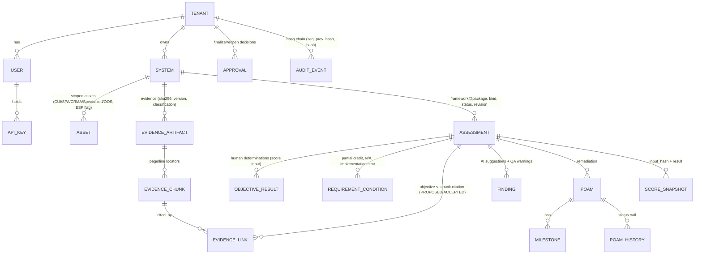

# Data model

All customer tables carry `tenant_id` (FK, indexed) and are covered by PostgreSQL row-level
security (migration `0002`). Framework catalogs are immutable versioned files, not tables, so a
catalog revision can never silently change a past assessment.

## Constraints worth knowing
- `objective_results (assessment_id, objective_id)` unique — one current determination per objective;
  the audit log keeps every change.
- `audit_events (tenant_id, seq)` unique; the app role has no UPDATE/DELETE on it in PostgreSQL.
- `api_keys.prefix` unique; only an HMAC of the secret is stored.
- Retention: `tenants.retention_days` (default 2,555 ≈ 7 years). Enforcement job is backlog item B-14.

## Entities from the master prompt not yet implemented
Role (roles are an enum today), InformationType, DataFlow (stored as JSON on System), Risk (derived
from POA&Ms), SSP/AssessmentPlan/AssessmentReport (generated, not persisted), AuthorizationDecision,
Connector, IntegrationRun, Notification. See backlog.
